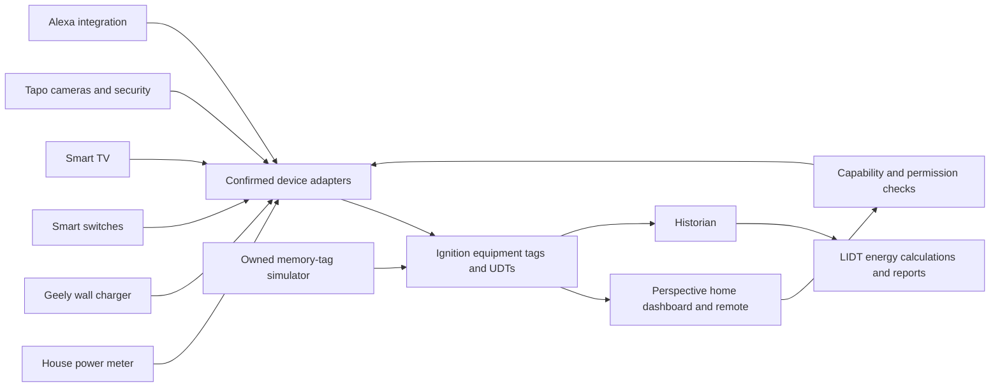

# Home energy and smart remote architecture

Only the simulator and native project resources are implemented in this base. The physical adapters remain unconfigured. Command code has no network client, protocol connection or device credentials and rejects non-memory tag destinations.

| Area | Base behavior | Before physical integration |
|---|---|---|
| Household energy | Simulated one-meter totaliser and power trend | Meter model, units, phases, data interface and tariff |
| EV charger | Simulated status, power, current limit and session energy | Geely model and documented supported output/control |
| Switches | Eight editable example positions | Actual count, room names and supported API/protocol |
| TV | Simulated power, volume, mute and input | TV model and available commands |
| Alexa | Demo scene composition | Supported Alexa integration and authorized routines |
| Tapo security | Simulated mode, motion and door state | Actual cameras/hub/sensors, supported interfaces and roles |

Real remote access is a separate commissioning step. The base does not expose the Gateway to the internet or change network security settings.

The live demo trend retains 180 recent samples in the project library. Simulation advances while a screen polls it; time gaps are capped so missing execution does not manufacture energy history. For a continuously running test, add the supplied `gateway-timer.py` through Designer Gateway Events using a fixed delay of 1,000 ms. The simulator lock and elapsed-time check prevent duplicate energy integration if a timer and more than one screen call it.

The prototype uses the already configured sample SQLite historian. A dedicated home historian, validated data retention and backup/restore process should be chosen before connecting physical readings. Imported/exported units and meter-reset handling need device-specific verification before billing.
